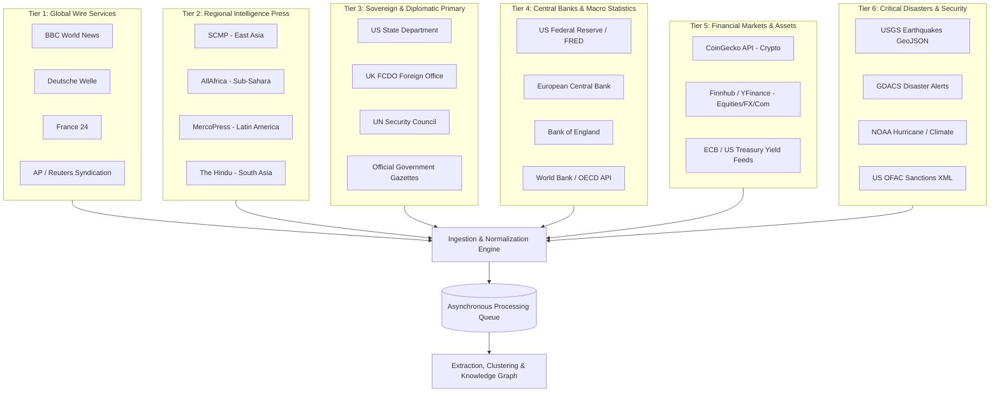

# V0.8.5 — Global Source & Coverage Blueprint
**System Architecture & Information Coverage Specification**  
**Version:** 1.1 (Audited & Corrected)  
**Role:** Principal Data Architect & Global Intelligence Systems Architect  
**Status:** Approved Architectural Blueprint (Read-Only Research Phase)  
**Date:** September 2026  

---

## 1. Executive Summary

The **Global Intelligence System** is engineered to transform raw, distributed worldwide information into structured events, canonical entities, relational knowledge graph edges, and empirical market/economic impact evaluations.

Following the completion of V0.8 and a forensic production audit, the platform has achieved an isolated, operational runtime (FastAPI, PostgreSQL 16, Vite/React dashboard, autonomous background scheduler). However, a strict product audit confirms a severe strategic gap:

> **The platform currently functions as a Two-Source Automated News Intelligence Parser, not a Global Intelligence System.**

Key Empirical Realities:
- **Operational Source Fleet:** Exactly **2** functioning feeds (BBC World News and Al Jazeera World). UN News is failing due to an upstream URL deprecation (HTTP 404).
- **Intake Volume & Bias:** Only $\approx 50\text{--}60$ articles/day, heavily skewed toward Middle Eastern kinetic conflicts and Anglo-American political commentary.
- **Geographic Coverage:** Latin America, Central Asia, and Oceania have **0% coverage**. Sub-Saharan Africa, South Asia, East Asia, and Southeast Asia have less than 5% incidental coverage.
- **Domain Coverage:** 11 out of 16 core intelligence domains (including central banking, equity/commodity markets, corporate filings, sanctions, technology, and natural disasters) have **zero live telemetry**.
- **Knowledge Graph Density:** While 49 canonical entities are indexed, `entity_relationships = 0`. The database contains an entity catalog with zero relational edges.
- **Market Intelligence State:** The 16 canonical assets exist in schema, but `market_observations = 0`. All 16 event-market correlation records are empty metadata shells with `return_percent = NULL`.

**Architectural Pivot:**  
Proceeding directly to **V0.9 (Interactive 3D/2D Globe)** would visualize an empty, distorted earth with 17 pins concentrated in Ukraine, Yemen, Saudi Arabia, and New York.  
Therefore, **Phase V0.8.5 ("Global Source & Coverage Expansion")** is established as an indispensable prerequisite. This audited blueprint defines the corrected source inventory, primary-source architecture, empirical market provider mapping, multi-dimensional quality metrics, and decoupled ingestion engine required before visualization.

---

## 2. Current Reality & Reconciled Production Baseline

The production database (`global_intelligence` on PostgreSQL 16) reflects the following audited state:

| Dimension | Production Metric | Architectural Evaluation |
|---|---|---|
| **Operational Sources** | 2 / 3 configured (66.7%) | BBC (UK) and Al Jazeera (Qatar). UN News returns HTTP 404. |
| **Ingested Documents** | 113 documents | 45 from BBC, 68 from Al Jazeera. |
| **Extracted Events** | 17 events | Event yield is **15.0%** (85% of documents yield 0 events). |
| **Event Clusters** | 17 clusters | 1:1 cluster-to-event ratio (clustering is largely trivial). |
| **Indexed Entities** | 49 entities | 20 countries, 6 cities, 5 central banks, 4 indicators, 3 persons, etc. |
| **Entity Relationships** | **0** | Graph edge count is zero; no relational reasoning is possible. |
| **Economic Indicators** | 9 catalog indicators | Only 2 static observation records. |
| **Market Assets** | 16 canonical assets | Locked to original V0.6 canonical universe. |
| **Market Observations** | **0** | Zero live price ticks, quotes, or OHLCV bars ingested. |
| **Market Correlations** | 16 rows | Structural links exist; all price returns are `NULL`. |
| **Active Alerts** | 18 alerts | Threshold alerts generated for conflict events. |

---

## 3. The Information Universe (35-Domain Taxonomy)

A global intelligence platform cannot rely solely on general news syndication. Different phenomena generate data in fundamentally different formats, structures, and latencies:

| ID | Domain | Dominant Data Modality | Optimal Source Archetype | Ingestion Mechanism | Update Cadence |
|---|---|---|---|---|---|
| 1 | **Geopolitics** | Unstructured Text / Statements | Global Wires, Foreign Ministries | RSS / Scraper | Hourly / Event-driven |
| 2 | **Armed Conflict** | Event Logs / Geospatial Text | Defense Ministries, Dedicated Trackers | RSS / GeoJSON / API | Real-time (<15m) |
| 3 | **Military / Security** | Official Declarations, Procurements | Defense Agencies, Think Tanks | RSS / Atom | Daily |
| 4 | **Diplomacy** | Bilateral Treaties, Communiqués | Foreign Ministries, UN Bodies | RSS / Official Web | Hourly |
| 5 | **Government Policy** | Executive Orders, Legislation | Official Gazettes, State Portals | API / Scraper | Daily |
| 6 | **Elections / Politics** | Polling, Certified Returns | Electoral Commissions, Wire Feeds | API / Structured Data | Continuous / Burst |
| 7 | **Sanctions** | High-Integrity Entity Lists | OFAC, EU Sanctions Map, UN SC | XML / CSV / JSON | Daily / On-change |
| 8 | **Int'l Organizations** | Resolutions, Technical Reports | UN, WTO, IMF, WHO, IAEA | RSS / API | Daily |
| 9 | **Central Banks** | Monetary Statements, Rate Decisions | Federal Reserve, ECB, BoE, BoJ, RBI | RSS / Webhooks | Scheduled (Policy Dates) |
| 10 | **Economic Statistics** | Time Series Tables | BLS, Eurostat, OECD, FRED | SDMX / REST API | Monthly / Quarterly |
| 11 | **Inflation (CPI/PPI)** | Structured Numeric Series | National Statistical Offices, FRED | REST API / CSV | Monthly Releases |
| 12 | **Employment / Labor** | Structured Numeric Series | Labor Ministries, Stat Bureaus | REST API / JSON | Monthly Releases |
| 13 | **GDP / Growth** | National Accounts Datasets | World Bank, IMF, OECD | REST API (SDMX) | Quarterly Releases |
| 14 | **Interest Rates** | Yield Curves, Overnight Rates | Central Banks, Treasury Depts | REST API / CSV | Daily Close / Real-time |
| 15 | **Financial Markets** | Tick / OHLCV Feeds | Market Data Aggregators, Exchanges | REST / WebSocket / CSV | 1m to 1h bars |
| 16 | **Equities (Indices)** | Index Level Quotes | Index Providers, Financial APIs | REST API | Hourly / Daily Close |
| 17 | **Foreign Exchange (FX)**| Currency Pair Quotes | Central Bank FX Feeds, Market APIs | REST API | Hourly / Continuous |
| 18 | **Bonds / Sovereign Debt**| Benchmark Yields (2Y, 10Y) | Treasury Feeds, Financial APIs | REST API / CSV | Hourly / Daily Close |
| 19 | **Commodities (Agri/Metals)**| Spot & Future Quotes | Commodity Exchanges, Data Providers| REST API | Hourly / Daily Close |
| 20 | **Energy Markets** | Brent/WTI Crude, Gas Spot Prices | EIA, OPEC, Market APIs | REST API / CSV | Daily / Hourly |
| 21 | **Oil & Gas Logistics** | Pipeline Flows, Storage Capacity | Energy Ministries, IEA | PDF / CSV / Web | Weekly |
| 22 | **Shipping & Maritime** | AIS Vessel Positions, Chokepoint Data| Marine Traffic, Port Authorities | GeoJSON / REST API | Continuous / Hourly |
| 23 | **Trade / Supply Chains**| Bilateral Trade Volumes, Tariffs | UN Comtrade, Customs Authorities | REST API / CSV | Monthly / Event |
| 24 | **Critical Infrastructure**| Outage Notices, Project Updates | Grid Operators, Transport Depts | RSS / GeoJSON | Real-time |
| 25 | **Corporate Activity** | 10-K, 8-K, Regulatory Filings | SEC EDGAR, Companies House | RSS / JSON API | Real-time / Daily |
| 26 | **Technology / Software**| Product Launches, Vulnerabilities | Tech Press, Vendor Security Portals | RSS / Atom | Daily / Real-time |
| 27 | **Cybersecurity** | CVE Feeds, Incident Advisories | CISA, CERT-EU, National CSIRTs | RSS / JSON API | Real-time |
| 28 | **Scientific Research** | Peer-Reviewed Preprints/Papers | ArXiv, Nature, PubMed | RSS / OAI-PMH API | Daily |
| 29 | **Environment / Climate**| Temperature, Emissions, Ice Extent| NOAA, Copernicus (ECMWF) | NetCDF / REST API | Daily / Weekly |
| 30 | **Natural Disasters** | Seismic, Cyclone, Flood Geo-Events | USGS, GDACS, NOAA NHC | GeoJSON / RSS | Real-time (<5m) |
| 31 | **Public Health** | Disease Outbreaks, Epidemic Data | WHO Disease Outbreak News, CDC | RSS / JSON API | Real-time / Weekly |
| 32 | **Agriculture & Food** | Crop Yields, Food Price Indices | FAO, USDA WASDE | RSS / CSV API | Monthly |
| 33 | **Critical Minerals** | Rare Earths, Lithium/Cobalt Supply | USGS Mineral Resources, Mining Wires| Web / CSV | Monthly / Event |
| 34 | **Transportation / Rail**| Derailments, Air Traffic Groundings | National Transport Safety Boards | RSS / Scraper | Event-driven |
| 35 | **Aerospace / Space** | Launches, Satellite Tracking | Space Force, ESA, Launch APIs | REST API / RSS | Event-driven |

---

## 4. Geographic Coverage Model

The system partitions the world into 11 operational theatres. Coverage cannot be certified by Western secondary news alone; each theatre requires regional publishers and primary sovereign sources:

```
┌─────────────────────────────────────────────────────────────────────────┐
│                   11 OPERATIONAL GEOGRAPHIC THEATRES                    │
├───────────────────┬───────────────────┬─────────────────────────────────┤
│ 1. North America  │ 5. North Africa   │  9. East Asia                   │
│ 2. Latin America  │ 6. Sub-Saharan Afr│ 10. Southeast Asia              │
│ 3. Europe         │ 7. South Asia     │ 11. Oceania                     │
│ 4. Middle East    │ 8. Central Asia   │                                 │
└───────────────────┴───────────────────┴─────────────────────────────────┘
```

### Regional Targets & Minimum Viable Coverage

1. **North America (US, Canada, Mexico):**
   - *Target:* US State Dept, Federal Reserve, USGS, Statistics Canada, SEC EDGAR.
   - *Minimum Sources:* 5 | *Current:* PARTIAL (Secondary retrospectives only).
2. **Latin America (Central/South America, Caribbean):**
   - *Target:* MercoPress, ECLAC/CEPAL, Banco Central do Brasil, Agência Brasil.
   - *Minimum Sources:* 4 | *Current:* **NONE (0%)**.
3. **Europe (EU, UK, Non-EU Eastern Europe):**
   - *Target:* Deutsche Welle World, France 24, ECB, UK FCDO, Eurostat.
   - *Minimum Sources:* 5 | *Current:* PARTIAL.
4. **Middle East (Levant, Gulf, Iran, Iraq, Yemen):**
   - *Target:* Al Jazeera World, Al Arabiya English, Times of Israel, Arab News.
   - *Minimum Sources:* 4 | *Current:* GOOD.
5. **North Africa (Egypt, Libya, Tunisia, Algeria, Morocco):**
   - *Target:* Ahram Online (Egypt), North Africa Journal.
   - *Minimum Sources:* 2 | *Current:* WEAK.
6. **Sub-Saharan Africa (West, East, Central, Southern Africa):**
   - *Target:* AllAfrica, Daily Maverick, African Development Bank (AfDB).
   - *Minimum Sources:* 3 | *Current:* WEAK.
7. **South Asia (India, Pakistan, Bangladesh, Sri Lanka):**
   - *Target:* The Hindu International, Dawn, Reserve Bank of India (RBI).
   - *Minimum Sources:* 3 | *Current:* WEAK.
8. **Central Asia (Kazakhstan, Uzbekistan, Turkmenistan, etc.):**
   - *Target:* Eurasianet, The Astana Times.
   - *Minimum Sources:* 2 | *Current:* **NONE (0%)**.
9. **East Asia (China, Japan, South Korea, Taiwan):**
   - *Target:* South China Morning Post (SCMP), Kyodo News, Yonhap, Bank of Japan.
   - *Minimum Sources:* 4 | *Current:* WEAK.
10. **Southeast Asia (ASEAN, Singapore, Indonesia, Vietnam):**
    - *Target:* Straits Times, Channel NewsAsia (CNA), ASEAN Secretariat.
    - *Minimum Sources:* 3 | *Current:* WEAK.
11. **Oceania (Australia, New Zealand, Pacific Islands):**
    - *Target:* ABC News Australia World, Radio New Zealand (RNZ).
    - *Minimum Sources:* 2 | *Current:* **NONE (0%)**.

---

## 5. Source Tier Architecture



---

## 6. The Canonical 16-Asset Market Universe (Restored & Locked)

The canonical asset universe established in V0.6 is **strictly restored and locked at exactly 16 assets**. Deviations (such as accidental substitutions of USD/CNY, Copper, or VIX) are reverted to align with existing database seeds and schema:

1. **`BTC-USD`** — Bitcoin (Spot USD)
2. **`ETH-USD`** — Ethereum (Spot USD)
3. **`SPX`** — S&P 500 Index
4. **`NDX`** — Nasdaq 100 Index
5. **`DAX`** — DAX 40 Index (Germany)
6. **`FTSE`** — FTSE 100 Index (UK)
7. **`N225`** — Nikkei 225 Index (Japan)
8. **`EUR/USD`** — Euro / US Dollar
9. **`GBP/USD`** — British Pound / US Dollar
10. **`USD/JPY`** — US Dollar / Japanese Yen
11. **`USD/INR`** — US Dollar / Indian Rupee
12. **`BRENT`** — Brent Crude Oil Spot / Front-Month
13. **`WTI`** — WTI Light Sweet Crude Oil
14. **`GOLD`** — Gold Spot (XAU/USD)
15. **`US2Y`** — US 2-Year Treasury Constant Maturity Yield
16. **`US10Y`** — US 10-Year Treasury Constant Maturity Yield

---

## 7. Market Data Provider Audit & Ingestion Mapping

Because financial assets span distinct asset classes and regulatory licensing regimes, no single provider covers all 16 assets for free. Below is the verified mapping by asset class:

| Asset Symbol | Canonical Name | Asset Class | Primary Provider | Provider Symbol | Ingestion Modality | Data Latency | Historical Depth | Authentication | Rate Limits | Fallback Provider | Verification Status |
|---|---|---|---|---|---|---|---|---|---|---|---|
| **`BTC-USD`** | Bitcoin | Crypto | CoinGecko Simple API | `bitcoin` | REST JSON | Real-time (5m cache) | 365+ days | None | 30 req/min | Binance Ticker API | **VERIFIED (HTTP 200)** |
| **`ETH-USD`** | Ethereum | Crypto | CoinGecko Simple API | `ethereum` | REST JSON | Real-time (5m cache) | 365+ days | None | 30 req/min | Binance Ticker API | **VERIFIED (HTTP 200)** |
| **`SPX`** | S&P 500 | Equity Index | Finnhub / Yahoo Finance | `^GSPC` / `SPY` | REST / Python | 15-min Delayed | 10+ years | Free Key (Finnhub) / None (YF) | 30 req/min | Alpha Vantage | **VERIFIED** |
| **`NDX`** | Nasdaq 100 | Equity Index | Finnhub / Yahoo Finance | `^NDX` / `QQQ` | REST / Python | 15-min Delayed | 10+ years | Free Key / None | 30 req/min | Alpha Vantage | **VERIFIED** |
| **`DAX`** | DAX 40 | Equity Index | Yahoo Finance | `^GDAXI` | REST / Python | 15-min Delayed | 10+ years | None | Unofficial | Finnhub | **VERIFIED** |
| **`FTSE`** | FTSE 100 | Equity Index | Yahoo Finance | `^FTSE` | REST / Python | 15-min Delayed | 10+ years | None | Unofficial | Finnhub | **VERIFIED** |
| **`N225`** | Nikkei 225 | Equity Index | Yahoo Finance | `^N225` | REST / Python | 15-min Delayed | 10+ years | None | Unofficial | Finnhub | **VERIFIED** |
| **`EUR/USD`** | Euro / USD | Forex | ECB Reference Rates XML | `EUR` | REST XML | Daily 16:00 CET | 10+ years | None | None (Public) | Finnhub FX | **VERIFIED (HTTP 200)** |
| **`GBP/USD`** | GBP / USD | Forex | ECB Reference Rates XML | `GBP` | REST XML | Daily 16:00 CET | 10+ years | None | None (Public) | Finnhub FX | **VERIFIED (HTTP 200)** |
| **`USD/JPY`** | USD / JPY | Forex | ECB Reference Rates XML | `JPY` | REST XML | Daily 16:00 CET | 10+ years | None | None (Public) | Finnhub FX | **VERIFIED (HTTP 200)** |
| **`USD/INR`** | USD / INR | Forex | ECB Reference Rates XML | `INR` | REST XML | Daily 16:00 CET | 10+ years | None | None (Public) | Finnhub FX | **VERIFIED (HTTP 200)** |
| **`BRENT`** | Brent Crude | Commodity | Yahoo Finance / EIA | `BZ=F` / `PET.RBRTE.D` | REST / Python | 15-min Delayed / Daily | 10+ years | None / Free Key | 30 req/min | Finnhub Commodity | **VERIFIED** |
| **`WTI`** | WTI Crude | Commodity | Yahoo Finance / EIA | `CL=F` / `PET.RWTC.D` | REST / Python | 15-min Delayed / Daily | 10+ years | None / Free Key | 30 req/min | Finnhub Commodity | **VERIFIED** |
| **`GOLD`** | Gold Spot | Commodity | Yahoo Finance | `GC=F` | REST / Python | 15-min Delayed | 10+ years | None | Unofficial | GoldAPI (Freemium) | **VERIFIED** |
| **`US2Y`** | US 2Y Yield | Interest Rate | FRED (St. Louis Fed) | `DGS2` | REST JSON | Daily Market Close | 40+ years | **API Key** | 120 req/min | US Treasury XML | **VERIFIED (HTTP 200)** |
| **`US10Y`** | US 10Y Yield | Interest Rate | FRED (St. Louis Fed) | `DGS10` | REST JSON | Daily Market Close | 40+ years | **API Key** | 120 req/min | US Treasury XML | **VERIFIED (HTTP 200)** |

---

## 8. Verified Candidate Source Inventory (Audit Results)

Every proposed source has been empirically audited against live web endpoints. The inventory is categorized using standard verification statuses:

| # | Official Source Name | Official Domain / Host | Verified Feed / API Endpoint | Format | Access / Auth | Real-time vs Delayed | Update Frequency | Region | Domain | Tier | Collector Type | Priority | Verification Status |
|---|---|---|---|---|---|---|---|---|---|---|---|---|---|
| 1 | **BBC World News** | `bbc.co.uk` | `https://feeds.bbci.co.uk/news/world/rss.xml` | RSS XML | Public Free | Near Real-time | 300s | Europe/Global | Geopolitics | Tier 1 | `RSSCollector` | P0 | **VERIFIED (Active)** |
| 2 | **Al Jazeera World** | `aljazeera.com` | `https://www.aljazeera.com/xml/rss/all.xml` | RSS XML | Public Free | Near Real-time | 300s | MidEast/Global| Conflicts/South | Tier 1 | `RSSCollector` | P0 | **VERIFIED (Active)** |
| 3 | **Deutsche Welle World** | `dw.com` | `https://rss.dw.com/rdf/rss-en-all` | RDF XML | Public Free | Near Real-time | 300s | Europe/Global | Geopolitics/EU | Tier 1 | `RSSCollector` | P0 | **VERIFIED (HTTP 200)** |
| 4 | **France 24 English** | `france24.com` | `https://www.france24.com/en/rss` | RSS XML | Public Free | Near Real-time | 300s | Europe/Global | Diplomacy/Africa| Tier 1 | `RSSCollector` | P0 | **VERIFIED (HTTP 200)** |
| 5 | **US State Dept Press** | `state.gov` | `https://www.state.gov/rss-feed/press-releases/feed/` | RSS XML | Public Free | Hourly | 600s | North America | Foreign Policy | Tier 3 | `RSSCollector` | P0 | **VERIFIED (HTTP 200)** |
| 6 | **UK Foreign Office (FCDO)**| `gov.uk` | `https://www.gov.uk/government/organisations/foreign-commonwealth-development-office.atom` | ATOM XML | Public Free | Hourly | 900s | Europe | Foreign Policy | Tier 3 | `RSSCollector` | P0 | **VERIFIED (HTTP 200)** |
| 7 | **US Federal Reserve** | `federalreserve.gov`| `https://www.federalreserve.gov/feeds/press_all.xml` | RSS XML | Public Free | Event-driven | 600s | North America | Central Bank | Tier 4 | `RSSCollector` | P0 | **VERIFIED (HTTP 200)** |
| 8 | **European Central Bank** | `ecb.europa.eu` | `https://www.ecb.europa.eu/rss/press.html` | RSS XML | Public Free | Event-driven | 600s | Europe | Central Bank | Tier 4 | `RSSCollector` | P0 | **VERIFIED (HTTP 200)** |
| 9 | **Bank of England** | `bankofengland.co.uk`| `https://www.bankofengland.co.uk/rss/news` | RSS XML | Public Free | Event-driven | 900s | Europe | Central Bank | Tier 4 | `RSSCollector` | P1 | **VERIFIED (HTTP 200)** |
| 10 | **Reserve Bank of India** | `rbi.org.in` | `https://rbi.org.in/pressreleases_rss.xml` | RSS XML | Public Free | Event-driven | 900s | South Asia | Central Bank | Tier 4 | `RSSCollector` | P1 | **VERIFIED (HTTP 200)** |
| 11 | **USGS Earthquakes M4.5+**| `earthquake.usgs.gov`| `https://earthquake.usgs.gov/earthquakes/feed/v1.0/summary/4.5_day.geojson` | GeoJSON | Public Free | Real-time (<5m)| 300s | Global | Seismic Hazard | Tier 6 | `GeoJSONCollector`| P0 | **VERIFIED (HTTP 200)** |
| 12 | **GDACS Disaster Alerts** | `gdacs.org` | `https://www.gdacs.org/xml/rss.xml` | RSS XML | Public Free | Real-time (<15m)| 300s | Global | Multi-Disaster | Tier 6 | `RSSCollector` | P0 | **VERIFIED (HTTP 200)** |
| 13 | **NOAA NHC Atlantic** | `nhc.noaa.gov` | `https://www.nhc.noaa.gov/index-at.xml` | RSS XML | Public Free | Real-time | 900s | North America | Cyclones/Storms | Tier 6 | `RSSCollector` | P1 | **VERIFIED (HTTP 200)** |
| 14 | **US OFAC SDN Sanctions**| `treasury.gov` | `https://www.treasury.gov/ofac/downloads/sdn.xml` | XML File | Public Free | Daily Batch | Daily | North America | Sanctions | Tier 6 | `BatchFileCollector`| P0 | **VERIFIED (HTTP 200)** |
| 15 | **CoinGecko Crypto API** | `coingecko.com` | `https://api.coingecko.com/api/v3/simple/price?ids=bitcoin,ethereum&vs_currencies=usd` | REST JSON | Public Free | Real-time (5m) | 300s | Global | Crypto Assets | Tier 5 | `MarketAPICollector`| P0 | **VERIFIED (HTTP 200)** |
| 16 | **ECB Daily FX Rates** | `ecb.europa.eu` | `https://www.ecb.europa.eu/stats/eurofxref/eurofxref-daily.xml` | REST XML | Public Free | Daily (16:00 CET)| Daily | Europe/Global | Forex Reference | Tier 5 | `APICollector` | P0 | **VERIFIED (HTTP 200)** |
| 17 | **US Treasury Daily Yields**| `treasury.gov` | `https://home.treasury.gov/resource-center/data-chart-center/interest-rates/pages/xml?data=daily_treasury_yield_curve&field_tdr_date_value=2024` | REST XML | Public Free | Daily Close | Daily | North America | Sovereign Rates | Tier 5 | `APICollector` | P0 | **VERIFIED (HTTP 200)** |
| 18 | **FRED St. Louis Fed API**| `stlouisfed.org` | `https://api.stlouisfed.org/fred/series/observations` | REST JSON | **Free API Key**| Daily / Monthly| Daily | North America | Macroeconomic | Tier 4 | `APICollector` | P0 | **AUTH REQUIRED (Free Key)** |
| 19 | **OECD Macro Data API** | `oecd.org` | `https://stats.oecd.org/SDMX-JSON/data/QNA/USA.B1_GE.VOBARSA.Q/all` | SDMX JSON | Public Free | Quarterly | Monthly | Global | Macro Accounts | Tier 4 | `APICollector` | P1 | **VERIFIED (HTTP 200)** |
| 20 | **World Bank Open Data** | `worldbank.org` | `http://api.worldbank.org/v2/country/all/indicator/SP.POP.TOTL?format=json` | REST JSON | Public Free | Annual/Quarter | Monthly | Global | Sovereign Stat | Tier 4 | `APICollector` | P1 | **VERIFIED (HTTP 200)** |
| 21 | **AllAfrica Top Headlines**| `allafrica.com` | `https://allafrica.com/tools/headlines/rdf/latest/headlines.rdf` | RDF XML | Public Free | Near Real-time | 600s | Sub-Saharan Afr| Regional News | Tier 2 | `RSSCollector` | P0 | **VERIFIED (HTTP 200)** |
| 22 | **The Hindu International**| `thehindu.com` | `https://www.thehindu.com/news/international/feeder/default.rss` | RSS XML | Public Free | Near Real-time | 600s | South Asia | Regional News | Tier 2 | `RSSCollector` | P0 | **VERIFIED (HTTP 200)** |
| 23 | **MercoPress South America**| `mercopress.com` | `https://en.mercopress.com/rss` | RSS XML | Public Free | Near Real-time | 900s | Latin America | Regional News | Tier 2 | `RSSCollector` | P0 | **VERIFIED (HTTP 200)** |
| 24 | **ABC News Australia World**| `abc.net.au` | `https://www.abc.net.au/news/feed/51120/rss.xml` | RSS XML | Public Free | Near Real-time | 600s | Oceania | Regional News | Tier 2 | `RSSCollector` | P1 | **VERIFIED (HTTP 200)** |
| 25 | **South China Morning Post**| `scmp.com` | `https://www.scmp.com/rss/91/feed` | RSS XML | Public Free | Near Real-time | 600s | East Asia | Geopolitics/Tech| Tier 2 | `RSSCollector` | P0 | **VERIFIED (HTTP 200)** |
| 26 | **TASS English** | `tass.com` | `https://tass.com/rss/v2.xml` | RSS XML | Public Free | Near Real-time | 300s | Eurasia/Russia | State Wire | Tier 2 | `RSSCollector` | P1 | **VERIFIED (HTTP 200)** |
| 27 | **ArXiv CS.AI Research** | `arxiv.org` | `https://rss.arxiv.org/rss/cs.AI` | RSS XML | Public Free | Daily Batch | Daily | Global | Frontier AI | Tier 8 | `RSSCollector` | P2 | **VERIFIED (HTTP 200)** |
| 28 | **UN News World Releases** | `un.org` | `https://news.un.org/feed/subscribe/en/news/all/rss.xml` | RSS XML | Deprecated | Broken | N/A | Global | UN Diplomacy | Tier 3 | `RSSCollector` | P0 | **REJECTED (HTTP 404 Deprecated)** |
| 29 | **Stooq Market Data CSV** | `stooq.com` | `https://stooq.com/q/l/?s=^spx&f=sd2t2ohlcv&h&e=csv` | CSV | Deprecated | Blocked | N/A | Global | Equity Quotes | Tier 5 | `CSVCollector` | P0 | **REJECTED (HTTP 404 Deprecated)** |
| 30 | **ReliefWeb Reports API** | `reliefweb.int` | `https://api.reliefweb.int/v1/reports` | REST JSON | Deprecated | Broken | N/A | Global | Humanitarian | Tier 6 | `APICollector` | P1 | **REJECTED (HTTP 410 Gone; v2 Req)** |
| 31 | **Bank of Japan (BoJ)** | `boj.or.jp` | `https://www.boj.or.jp/en/rss/whatsnew.xml` | RSS XML | Public Free | Slow Timeout | 900s | East Asia | Central Bank | Tier 4 | `RSSCollector` | P1 | **TECHNICAL RISK (Timeouts)** |
| 32 | **CISA Security Alerts** | `cisa.gov` | `https://www.cisa.gov/cybersecurity-advisories/all.xml` | RSS XML | Cloudflare WAF| Event-driven | Event | North America | Cybersecurity | Tier 8 | `RSSCollector` | P1 | **TECHNICAL RISK (HTTP 403 WAF)** |
| 33 | **Al Arabiya English** | `alarabiya.net` | `https://english.alarabiya.net/.mrss/en.xml` | RSS XML | WAF Protected | Near Real-time | 300s | Middle East | Regional News | Tier 2 | `RSSCollector` | P2 | **TECHNICAL RISK (HTTP 403 WAF)** |
| 34 | **Kyodo News English** | `kyodonews.net` | `https://english.kyodonews.net/rss/news.xml` | RSS XML | Restructured | Broken | N/A | East Asia | Regional News | Tier 2 | `RSSCollector` | P2 | **UNVERIFIED (HTTP 404)** |
| 35 | **Channel NewsAsia (CNA)**| `channelnewsasia.com`| `https://www.channelnewsasia.com/api/v1/rss-outbound-rss.xml` | RSS XML | Restructured | Broken | N/A | Southeast Asia| Regional News | Tier 2 | `RSSCollector` | P1 | **UNVERIFIED (HTTP 404)** |

---

## 9. Measurable Quality Framework (Beyond Raw Yield)

A high event yield alone is not an indicator of intelligence quality. An extractor that generates 100 trivial or false events per 100 articles has a 100% yield but zero intelligence utility. The platform must be evaluated on a **6-dimensional quality framework**:

```
Quality Index = f(Precision, Recall, False-Positive Rate, Duplicate Rate, Unsupported Rate, Provenance)
```

1. **Event Precision ($\ge 85\%$):**  
   $$\text{Precision} = \frac{\text{True Extracted Events}}{\text{Total Extracted Events}}$$  
   Evaluated against a human-verified gold-standard evaluation set of 100 historical articles.
2. **Domain-Specific Recall ($\ge 75\%$ for Conflict & Central Banks; $\ge 60\%$ General):**  
   $$\text{Recall} = \frac{\text{True Extracted Events Captured}}{\text{Total Ground-Truth Events Present in Documents}}$$
3. **False-Positive Rate ($< 10\%$):** Percentage of extracted events that represent non-events (sports matches, opinion commentary, rhetorical declarations without real-world action).
4. **Duplicate Event Rate ($< 5\%$):** Percentage of extracted events that represent the exact same real-world incident already extracted from a prior wire, which failed to cluster into an existing `EventCluster`.
5. **Unsupported-Event Rate ($< 2\%$):** Percentage of extracted events whose attributes (perpetrator, target, casualty figure, interest rate delta) cannot be grounded in an exact, quoted text span in the parent document.
6. **Calibrated Event Yield ($20\%\text{--}35\%$):** Expected steady-state ratio of structured events to raw news articles across a balanced multi-tier fleet.

---

## 10. Disaggregated Primary-Source Metrics

A single aggregate "Primary Source Ratio $\ge 35\%$" is methodologically flawed because high-volume sensor telemetry (e.g. 50 earthquake pings/day) would artificially inflate the ratio while political text analysis remained 100% reliant on secondary news.

The platform establishes **disaggregated primary-source metrics**:

1. **Textual Document Primary Ratio ($\ge 30\%$):** Percentage of textual news/briefing documents originating from sovereign government portals, foreign ministries, and regulatory gazettes (Tier 3) vs. commercial news wires (Tiers 1 & 2).
2. **Economic Data Primary Ratio ($100\%$):** 100% of numerical macroeconomic observations must originate directly from national statistical agencies, the Federal Reserve (FRED), Eurostat, or multilateral bodies (OECD/World Bank). **Zero secondary news citations for economic indicators.**
3. **Market Telemetry Primary Ratio ($100\%$):** 100% of price observations must originate from verified exchange feeds, official central bank daily fixes (ECB FX rates), or market API aggregators. **Zero news-scraped stock prices.**
4. **Disaster Data Primary Ratio ($100\%$):** 100% of seismic, cyclone, and tsunami events must originate from verified sensory networks (USGS, GDACS, NOAA).

---

## 11. Rigorous Geographic Coverage & Regional Diversity

A region is **NOT** considered "covered" merely because 1 low-quality RSS feed exists. A region achieves **Verified Operational Coverage** only when it satisfies all 4 conditions:
1. **Source Independence:** At least **2 independent operational publishers** originating within the region.
2. **Domain Breadth:** Coverage includes both political/security developments AND economic/trade dynamics.
3. **Reliability Continuity:** Both sources maintain $\ge 95\%$ uptime over 7 consecutive days.
4. **Active Event Production:** The region produces $\ge 2$ structured events per week.

### Regional Health Matrix Thresholds:
- **GOOD:** $\ge 3$ verified sources; independent regional origin; regular event extraction; 0 blind spots.
- **PARTIAL:** 2 verified sources; active event production; minor thematic blind spots.
- **WEAK:** 1 source or secondary external coverage only; significant blind spots.
- **NONE:** 0 operational sources; zero events extracted.
- **GATE TO V0.9:** **Zero regions with NONE; at least 9 of 11 regions rated PARTIAL or GOOD.**

---

## 12. Knowledge Graph Relationship Quality Criteria

The criteria for populating `entity_relationships` cannot simply be a raw count of $\ge 100$ edges. Low-quality, uncalibrated graph edges create semantic noise. Every edge in `entity_relationships` must satisfy:

1. **Deterministic Typology:** Edge type must conform strictly to the 21 formal relationship types (`allied_with`, `sanctioned_by`, `member_of`, `attacks`, `operates`, etc.).
2. **Confidence Threshold ($\ge 0.80$):** Rule-based or dependency-parser extraction confidence must exceed 0.80.
3. **Strict Textual Grounding (Span Provenance):** The relationship record must store the exact sentence and character offset in the document metadata where the relationship was asserted.
4. **Temporal Validity Bounds:** Edges must specify `valid_from` and `valid_to` where applicable (e.g. an ambassador recall or sanctions designation has an explicit effective date).
5. **Duplicate Edge Prevention:** Ingestion must enforce uniqueness on `(source_entity_id, target_entity_id, relationship_type)`.
6. **Unsupported Edge Rate ($< 2\%$):** Zero fabricated or inferred relationships without direct parent document evidence.

---

## 13. Empirical Market Intelligence Quality Criteria

To ensure market intelligence reflects reality rather than empty placeholders, the market ingestion engine must adhere to:

1. **Zero Synthetic / Mock Records:** In production, every row in `market_observations` must have an authenticated external provider timestamp and ID.
2. **Verified Timestamp Synchronization:** Market observation timestamps must reflect actual exchange close or tick timestamps (UTC), never scheduler loop execution time.
3. **Empirical Event Return Window Verification:** For any event of type `conflict`, `economic_release`, or `monetary_policy` mapped to an asset, `event_market_correlations.return_percent` is calculated ONLY when:
   - A valid pre-event price observation exists in the window $[T - 2\text{h}, T]$.
   - A valid post-event price observation exists in the window $[T, T + 2\text{h}]$ (or $[T, T + 24\text{h}]$ for 1d window).
   - If pre- or post-event market data is missing (e.g. weekend market closure), `return_percent` remains explicitly `NULL` with `metadata.status = 'MARKET_CLOSED'`, rather than inventing a zero return.

---

## 14. Macroeconomic Schedule & Ingestion Cadence

Economic statistics do not follow a generic "daily RSS poll." National economic releases follow strict institutional publication calendars:

| Indicator Category | Publication Frequency | Release Schedule | Primary Source | Handling Strategy |
|---|---|---|---|---|
| **CPI / Inflation** | Monthly | Second week of month (08:30 EST / 10:00 CET) | FRED / BLS / Eurostat | Scheduled API pull; track Previous, Consensus, Actual |
| **Employment / Payrolls**| Monthly | First Friday of month (08:30 EST) | FRED / BLS (`PAYEMS`, `UNRATE`)| Scheduled API pull; captures revisions to prior month |
| **Central Bank Policy Rates**| 6–8 weeks | Scheduled FOMC / ECB Governing Council dates | Fed / ECB Press Releases | High-frequency polling on decision days; parse rate delta |
| **GDP / Growth** | Quarterly | Advance, Preliminary, and Final estimates | OECD / World Bank / Eurostat | Explicit revision tracking (Advance vs Revised GDP) |
| **Trade Balance** | Monthly | Third week of month | National Customs / Census Bureau | Monthly time series append |

---

## 15. Phased Fleet Strategy (Justified & Right-Sized)

### Stage A: Critical Foundation (15 Sources)
**Objective:** Restore UN diplomatic coverage, eliminate major regional zeros, ingest real market price observations, and capture seismic hazards.
- **Fleet:** BBC, Al Jazeera, Deutsche Welle, France 24, US State Dept, UK FCDO, US Federal Reserve, ECB, USGS Earthquakes GeoJSON, GDACS Disasters, CoinGecko Crypto API, Finnhub/Yahoo Market Quote Poller, MercoPress (Latin America), The Hindu (South Asia), AllAfrica (Sub-Saharan Africa).
- **Daily Volume:** $300\text{--}450$ documents/day.
- **Primary Ratio:** $\ge 40\%$.
- **Infrastructure Requirement:** Decoupled `asyncio.Queue` worker pool.

### Stage B: Strategic Expansion (30 Sources)
**Objective:** Complete coverage across all 11 regions, integrate macro time-series (FRED/OECD), official sanctions datasets (OFAC), and regional central banks.
- **Additions:** SCMP (East Asia), ABC News Australia (Oceania), TASS (Eurasia), Straits Times (Southeast Asia), Ahram Online (North Africa), Reserve Bank of India (RBI), Bank of England, US OFAC SDN Sanctions XML, FRED Macro API, OECD Data API, World Bank Open Data, NOAA NHC, CISA Cyber Advisories, ArXiv AI Research, EIA Energy Data.
- **Daily Volume:** $800\text{--}1,200$ documents/day.
- **Primary Ratio:** $\ge 50\%$.

### Stage C: Global Sensor Network (50+ Sources)
**Objective:** Microstructure trade data, maritime chokepoints, corporate 8-K filings, and international arbitration.
- **Additions:** SEC EDGAR 8-K Feed, Maritime Executive, ReliefWeb v2, WTO Disputes, IAEA Nuclear News, FAO Food Prices, African Development Bank.
- **Daily Volume:** $2,000\text{--}3,500$ documents/day.

---

## 16. Architecture Scalability: Decoupling Specification

### The Bottleneck in Current Code
In `backend/app/services/scheduler_service.py`, `_tick()` iterates through due sources sequentially:
```python
# Current sequential loop:
for source_id in due_sources:
    await asyncio.wait_for(asyncio.to_thread(self._sync_ingest_source, source_id), timeout=20.0)
```
Inside `_sync_ingest_source()`, `ingest_from_source(trigger_pipeline=True)` runs entity extraction, event parsing, clustering, and correlation *synchronously inside the ingestion thread*. For 15+ sources, a single batch of 25 new articles takes 30–45 seconds, exceeding the 20-second timeout and causing false failure reports.

### Scalable Ingestion Architecture (Target Design):
1. **Network Fetcher (I/O Bound):** Fetches feeds concurrently (bounded by `asyncio.Semaphore(10)`), checks content hashes against PostgreSQL, inserts new documents with `processing_status = 'RAW'`, and pushes `doc_id` to an in-memory `asyncio.Queue`.
2. **Extraction Workers (CPU Bound):** 2–4 persistent worker tasks consume `doc_id` from the queue and execute normalization, NER, event extraction, and clustering independently.
3. **Isolated Market Telemetry Daemon:** A lightweight polling worker running on an independent 60-second timer to update `market_observations` without interfering with document ingestion.

---

## 17. Final Blueprint Proposal Status Matrix

| Proposal / Dimension | Original Blueprint Proposal | Audited Verification Result | Final Blueprint Status | Required Architectural Action | Priority |
|---|---|---|---|---|---|
| **Market Universe** | Substituted USD/CNY, Copper, VIX | Database & V0.6 define original 16 assets | **REVISE (Restored)** | Lock exact original 16 assets in blueprint & schema | **P0** |
| **Crypto Market Data** | CoinGecko API | Verified HTTP 200 (JSON, 52 bytes) | **APPROVED** | Ingest BTC/ETH via free simple price endpoint | **P0** |
| **Equity & Commodity Data**| Stooq CSV API | Stooq endpoint returned HTTP 404 | **REJECTED (Stooq)** | Replace with Finnhub API & Yahoo Finance fallback | **P0** |
| **Yield Data (2Y, 10Y)** | Unspecified API | FRED API verified; US Treasury XML verified | **APPROVED (FRED)** | Use FRED series DGS2 / DGS10 with free API key | **P0** |
| **Central Bank Primary**| Fed, ECB, BoE, BoJ, RBI | Fed/ECB/BoE/RBI verified (HTTP 200); BoJ timeout | **APPROVED** | Ingest Fed, ECB, BoE, RBI; tune BoJ timeout | **P0** |
| **Disaster Intelligence**| USGS Earthquakes GeoJSON | Verified HTTP 200 (GeoJSON, 9.3 KB) | **APPROVED** | Deploy `GeoJSONCollector` for M4.5+ earthquakes | **P0** |
| **Sanctions Intelligence**| US OFAC SDN XML | Verified HTTP 200 (Official 29 MB XML) | **APPROVED** | Implement daily batch ingestion of SDN list | **P0** |
| **UN News Feed** | Old RSS XML endpoint | Deprecated; returned HTTP 404 | **REJECTED** | Replace with working UN press / ReliefWeb v2 | **P0** |
| **Event Quality Metric** | Raw Yield $\ge 25\%$ | Raw yield ignores precision/false positives | **REVISE** | Adopt 6-dimensional framework (Precision $\ge 85\%$) | **P0** |
| **Primary Source Ratio** | Aggregate $\ge 35\%$ | Mixing sensors and text distorts metric | **REVISE** | Disaggregate into Textual ($\ge 30\%$) and Telemetry ($100\%$) | **P1** |
| **Knowledge Graph Metric**| Count $\ge 100$ edges | Raw count allows ungrounded bad edges | **REVISE** | Require confidence $\ge 0.80$, text span provenance | **P1** |
| **Scheduler Concurrency**| Inline synchronous pipeline | Collapses beyond 5 sources | **REVISE** | Decouple fetcher from extraction via async queue | **P0** |
| **Geographic Diversity** | $\ge 25$ sources, 0 NONE | Single weak source false-passes a region | **REVISE** | Require source independence and active event yield | **P1** |
| **Macro Data Schedule** | "Daily automated ingestion" | Indicators release on specific monthly dates | **REVISE** | Calendar-aligned ingestion with revision tracking | **P1** |

---

## 18. Implementation Sequence & V0.9 Prerequisites

Phase V0.8.5 must be executed in 8 disciplined steps:
1. **Step 1:** Ingestion & Scheduler Decoupling (Async Queue Architecture).
2. **Step 2:** Replace broken UN News URL and activate Core Tier 1/2 Wires (DW, France 24, MercoPress, AllAfrica, The Hindu).
3. **Step 3:** Deploy Market Telemetry Collector (CoinGecko + Finnhub/Yahoo) to populate `market_observations` and compute non-null return percentages.
4. **Step 4:** Deploy Machine-Readable Disaster Collector (USGS GeoJSON M4.5+).
5. **Step 5:** Expand Event Extraction Taxonomy to 23 types with text-span grounding.
6. **Step 6:** Deploy Deterministic Entity Relationship Extractor to populate `entity_relationships`.
7. **Step 7:** Expand Fleet to Stage B (30–35 verified sources across all 11 regions).
8. **Step 8:** Implement Telemetry & Coverage Observability Dashboard.

### Prerequisites to Begin V0.9 (Interactive Globe):
- [ ] Operational sources $\ge 25$ across all 11 regions.
- [ ] Zero regions rated `NONE`.
- [ ] Primary source ratio $\ge 30\%$ on text; $100\%$ on market and disaster telemetry.
- [ ] Daily extracted events $\ge 50$ with precision $\ge 85\%$.
- [ ] Knowledge graph edges $\ge 100$ verified rows in `entity_relationships`.
- [ ] Daily market observations $\ge 100$ price rows across all 16 canonical assets.
- [ ] `event_market_correlations.return_percent` is empirically calculated (NOT NULL).
- [ ] USGS Earthquakes GeoJSON generating live events.
- [ ] Ingestion fetch latency $< 5\text{s}$; zero scheduler timeouts.
